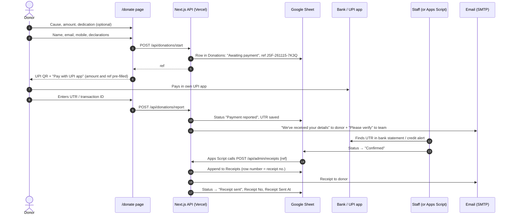

# 04 · Donations (UPI, no payment gateway)

This doc explains how the site collects donations at zero cost. It covers how payments are confirmed, how receipts reach donors without a database, and which Indian rules apply to a new non-profit.

> This is not legal or tax advice. Points marked **CA** should be confirmed with the foundation's chartered accountant.

## Summary

- **How donors pay:** UPI, straight into the foundation's current account. A QR code is shown with the amount and a reference filled in, plus a "Pay with UPI app" button on phones. Bank transfer (NEFT/IMPS) is the alternative.
- **Cost:** ₹0. No payment gateway, so no gateway fee. The rest of the stack is free too: Vercel Hobby, Google Sheets, Gmail SMTP and Apps Script.
- **The catch:** plain UPI doesn't tell the website that money arrived. The donor reports the transaction ID (UTR), and the payment is then confirmed in one of two ways:
  1. **Staff check (default):** a person finds the UTR in the bank statement and sets Status to `Confirmed` in the Sheet. This takes about a minute a day.
  2. **Bank-alert automation (optional, free):** an Apps Script reads the bank's credit-alert emails and confirms matching UTRs automatically.
- **Receipt email:** sent the moment a donation is marked `Confirmed`. The Apps Script trigger handles this; a daily job is the safety net.
- **Record of money:** the bank statement is the source of truth. The Sheet is the team's ledger, and its `Receipts` tab is the official list of receipts issued.

## The donor's journey

### Step 1: amount and cause (browser only)
- Cause buttons: Where it's needed most, plus the five focus areas.
- Preset amounts: ₹501, ₹1,100, ₹2,100, ₹5,100, ₹11,000, plus any whole amount from ₹100 to ₹2,00,000. Change these in `src/content/site.ts`.
- Each preset shows an impact line for the chosen cause, from `src/content/causes.ts`. **These lines are drafts; the foundation must approve them.**
- Links can pre-select a choice, for example `/donate?cause=education&amount=2100`. Cause pages and the home page use this.
- Optional "Dedicate this donation": in honour of someone, in memory of someone, or for an occasion.

### Step 2: details, `POST /api/donations/start`
- **Fields:**
  - name, email and mobile
  - "I am an Indian citizen and this donation is from my own funds" (required, for FCRA)
  - consent to the Terms and Privacy Policy
  - PAN and address only when 80G is switched on and the donor asks for an 80G receipt
- **Checks:** spam checks (honeypot, timing, optional Turnstile), then Zod validation.
- **What the server does:**
  - creates a reference such as `JSF-261115-7K3Q` (date in IST plus 4 random characters)
  - adds a `Donations` row with Status `Awaiting payment`
  - if the Sheet is down, still returns the reference; step 3 resends all the details, so nothing is lost

### Step 3: pay and report, `POST /api/donations/report`
- **UPI tab:**
  - a QR code with `upi://pay?pa=<UPI ID>&pn=Jeevansphere%20Foundation&am=<amount>&cu=INR&tn=<ref> Donation`
  - on phones, a "Pay with UPI app" button that opens the same link
  - the UPI ID, amount and reference, each with a copy button
  - a reminder to check that the payee name in the app reads **Jeevansphere Foundation**
- **Bank transfer tab:** account details with copy buttons, and a request to put the reference in the remarks.
- **Donor submits the UTR** (12 digits for UPI). The server then:
  - updates the row: `Paid Via`, `UTR`, `Reported At`, Status `Payment reported`
  - rejects a UTR that's already used on another donation
  - rejects a reference that belongs to a different email
  - emails the donor "We've received your donation details" and alerts the team ("Please verify ₹X, UTR …")
- **Resume:** progress is saved in the browser for 6 hours. A donor who switches to their UPI app and comes back, even after a page reload, lands back on step 3 with a "Welcome back" message.

### Step 4: confirmation and receipt
- **Staff:** filter `Donations` for Status `Payment reported`, find the UTR and amount in the bank statement or bank app, then set Status to `Confirmed` (or `Not received`).
- **Apps Script trigger:** the edit fires a trigger, which calls `POST /api/admin/receipts` with that reference (using `ADMIN_API_KEY`). The server then:
  - appends a row to the protected `Receipts` tab; the row number gives the receipt number
  - writes `Receipt No` back to the donation
  - emails the receipt
  - sets Status to `Receipt sent` with the time
- **Daily cron** (`/api/cron/daily`, about 09:00–10:00 IST):
  - sends any receipts still pending, for example if the Apps Script isn't installed or the email failed
  - emails the team a reminder about payments reported more than 24 hours ago and still unchecked

## Bank-alert automation (optional)

Most banks email a credit alert for every incoming UPI payment, and the alert includes the 12-digit UPI reference. `google-apps-script/Code.gs` can use these:
1. Every 15 minutes it searches Gmail with the query in `BANK_ALERT_QUERY`, for example `from:(alerts@yourbank.com) (credited OR received) newer_than:3d`.
2. It reads every 12-digit number and the first rupee amount in each alert.
3. When a number matches the UTR of a `Payment reported` donation **and** the amount matches, it sets Status to `Confirmed` with `Verified By = Auto: bank alert <time>` and triggers the receipt.
4. Anything that doesn't match exactly is left for staff. A wrong match is unlikely, because both the UTR and the amount must agree.

Requirements:
- Bank alerts must arrive in the Gmail account of the person who installed the script; set up forwarding if they go elsewhere.
- Test with a few small payments first. Alert formats differ between banks.
- NEFT/IMPS UTRs are alphanumeric, so the script doesn't auto-match them; staff confirm those.

## Receipts

**Number:** `JSF/<FY>/<sequence>`, for example `JSF/2026-27/00042`.
- The financial year runs April to March and comes from the date the payment was reported, in IST.
- The sequence is the row's position in the `Receipts` tab. Appends never share a row, so two receipts can't get the same number.
- This relies on rows in `Receipts` never being deleted, which is why the setup script protects that tab. A refunded donation is marked `Receipt Status = Cancelled`, never deleted.
- The sequence continues across years. If the CA wants numbering to restart each April, the site can switch to one tab per financial year. **CA**
- Processing is idempotent:
  - If a receipt row already exists for a donation, it is reused.
  - A donation is marked `Receipt sent` only after the email has gone out.

**What the receipt contains:**
- Receipt number and date received
- Donor name, address and PAN (if given)
- Amount in figures and in words (Indian numbering), and mode ("Electronic (UPI)" or "Electronic (bank transfer)")
- UTR, purpose (cause), donation type, dedication and the donation reference
- The foundation's legal name, registered office, legal status, CIN and PAN
- A tax note:
  - with 80G off: "80G approval is in process; not eligible for deduction"
  - with 80G on: the approval number and validity, and a note that Form 10BE follows after 10BD is filed
- The citizenship declaration, and the authorised signatory's name and designation

## Legal and compliance

| Topic | What it means for the site |
|---|---|
| FCRA | A new company won't be registered under FCRA, so the site accepts donations only from Indian citizens. The citizenship declaration is required, and international cards don't apply with UPI. Indian citizens abroad can donate from Indian accounts. **CA** |
| 12A / 80G | Keep `tax80g.enabled: false` in `src/content/site.ts` until approval. That hides all tax wording and the PAN fields. When approved, set it to `true` and fill in `approvalNumber`, `validFrom` and `validTo`. **CA** |
| Income-tax Act, 2025 | It replaced the 1961 Act from 1 April 2026 and renumbered sections. Teach For India's donate page cites "Section 133 of the Income Tax Act, 2025" for the donation deduction. Confirm the exact receipt wording with the CA before turning 80G on. **CA** |
| Form 10BD / 10BE | Every financial year, the CA files Form 10BD from the `Receipts` tab, then 10BE certificates go to donors, both by 31 May. The tab has the columns needed: name, address, PAN, amount, mode, donation type. **CA** |
| Cash | Not handled by the site. Cash donations above ₹2,000 don't qualify for 80G anyway. |
| Personal data | Name, phone, PAN and address are protected under the DPDP Act. The site uses a consent checkbox and a privacy policy, and Sheet access is limited to named staff. |

## Setting up the UPI ID

- Use a UPI ID linked to the **foundation's current account**, never a personal account.
- Ask the bank for a **business (merchant) UPI ID and QR** for the current account. UPI apps sometimes show warnings, or block pre-filled pay links, for personal UPI IDs; a merchant ID avoids this. Merchant UPI payments carry no fee for the receiver in most cases, but confirm any bank charges. The bank's business app can also send instant credit alerts.
- Put the UPI ID and bank details in `src/content/site.ts` (`donation.upiId`, `donation.bank`). Until they're set, the donate page shows a yellow "Setup needed" notice.
- Test: make a ₹1 payment from two different UPI apps (for example Google Pay and PhonePe), then check the payee name shown and that the note reaches your bank statement.

## Refunds

- `/refund-policy`: donations aren't refundable except for mistakes (a duplicate payment or the wrong amount), requested within 7 days.
- Refunds are paid back by UPI or bank transfer to the same account the donation came from. Staff set the donation's Status to `Refunded`. The sheet owner sets `Receipt Status` to `Cancelled` in `Receipts`, so the CA leaves it out of 10BD.

## Testing

| Where | How |
|---|---|
| Local, nothing configured | `npm run dev`. The full flow works; API routes log submissions to the terminal instead of saving them. |
| Local, with a test Sheet | Fill `.env.local`, run `npm run sheet:setup`, donate, set Status to `Confirmed`, then run the Apps Script menu "Send pending receipts now". This needs `SITE_URL` set to a URL the script can reach, such as a Vercel Preview deployment. |
| Preview / production | A real ₹1–₹10 UPI payment end to end: report the UTR, confirm it, check the receipt arrives, then refund it. |

Cases to check:
- a wrong UTR format
- the same UTR used twice
- reloading the page on step 3
- closing the tab after paying, so the payment is never reported (staff find it by the reference in the payment note)
- a receipt email failing, then going out from the cron
- 80G switched on and off

## Limits, and what's possible later

- **No automatic monthly giving.** UPI Autopay needs a payment gateway. A free alternative is a "Remind me monthly" email with a link to `/donate` (phase 4).
- **Confirmation isn't instant** unless bank-alert automation is on. The thank-you page and emails set the expectation of a receipt within 2 working days.
- **Adding a gateway later:** if the foundation later wants instant confirmation, cards or Autopay, Razorpay (or Cashfree or PayU) can be added as a second payment method next to UPI. The receipt, Sheet and email pipeline stays the same. Gateways charge a fee per payment.
